# methodJ · Spaced-repetition revision planner

[🇫🇷 Français](README.md) · 🇬🇧 English

methodJ is built on the **"J method"**: you don't read a course once, you review it at increasingly spaced intervals. When you add a course you give the day of the first session (**J0**); methodJ then places the following reviews at **J1, J3, J7, J15, J30, J60…** (J = *jour*, day: J7 is 7 days after J0). Each slot is validated once done. You stay in control: if you push a slot back, the following ones of the same course follow (cascade); intervals, lengths, hours and breaks are all adjustable.

Around that method, methodJ adds what it takes to keep the pace: a dashboard that flags overdue slots and smooths the load, free-review courses and a **revision period** before an exam, flashcards, statistics, and an export to your calendar.

> ⚠️ methodJ is a study-organisation tool. It provides no medical content and no medical advice.

## The J method

**Weekly planner**: slots can be dragged by finger or mouse, including from one day to another.


**Split screen** (tablet or large display): today's schedule on the left, the course catalogue and each course's repetition cycle (J0, J1, J3…) on the right.


**Course catalogue and folder tree**: file courses by subject › folder › sub-folder, filter in one click, give each folder a colour (or keep the automatic shade of its subject), resize the tree to your liking, and attach links (Drive, flashcards…) to each course.


What you can adjust:

- **A customisable method**: pick your intervals, save your defaults, set a default slot length plus exceptions per J.
- **Day, N-day, Week and Month views** with a time scale, slots you can drag by finger or mouse (also from one day to another), allowed hours and breaks (e.g. lunch) per weekday, which you can override for a single day.
- **Cascading reschedule**: if you push a slot back, the following unfinished ones follow.
- **Touch gestures**: swipe to change day, pinch to zoom the day.
- **Revision timer** with notes and a mastery self-assessment.
- **Course catalogue**, customisable subjects and colours (CSV/JSON import), a folder tree (subject › folder › sub-folder) to file and filter, links (Drive, flashcards…) attached to each course.

## Additional features

### Dashboard, smoothing and catch-up

Everything that needs an action in one place: overdue slots, days above your target, slots outside the working window, with smoothing and catch-up proposals that you tick before accepting them (never applied without your consent, and undoable). The rules are described in [docs/PLANNING_RULES.en.md](docs/PLANNING_RULES.en.md).


### Free review and revision period

A course can be in **free review** (no J scheduled): you add reviews (R) to it whenever you like, and switch it back to the J method later if needed; the dashboard flags a free course left aside.

Before an exam, the **revision period** organises a full pass: tick courses (subject › folder › course tree) and pick dates. methodJ switches those courses to free review and spreads their reviews over the period: a number of passes based on each course's mastery, evenly spaced, the last one near the exam, disciplines alternating (never a whole discipline on the same day) and the load smoothed. The period has its own hours, breaks and daily target, which replace yours on those dates; if it doesn't fit, methodJ suggests longer days, then a longer period. Everything is a **preview** (simulated planner, load day by day, passes per course): nothing changes before “Plan”, “Another spread” draws another arrangement, and the whole thing can be undone in one click. methodJ offers it when the exam gets close (adjustable, or always / never, in Preferences > Exam). See [the rules](docs/PLANNING_RULES.en.md#revision-period).

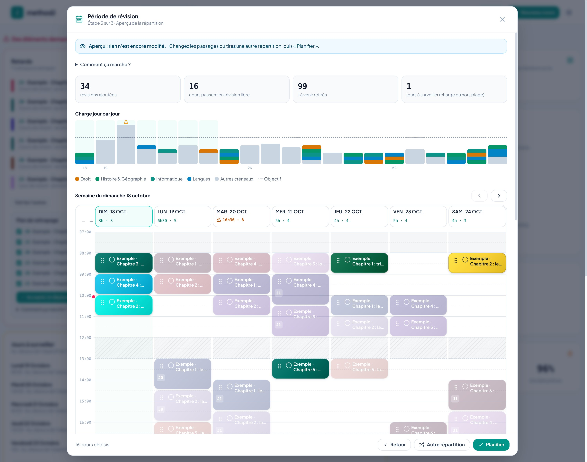

### Flashcards

Cards written in each course (front/back or cloze, with images: photo taken from the iPad, file, pasted screenshot or freehand drawing with finger or stylus, also to annotate an image; and image-occlusion cards on a diagram, like Anki's Image Occlusion), reviewed with the FSRS algorithm (Anki's): today's cards, or every card of a course, folder or subject, also from a J slot. CSV import (Anki “Notes in Plain Text” export or spreadsheet). A card can be created without a course: it waits in “Cards to sort” until you file it. Cards are stored on the device and synced per course (images through Cloud Storage, optional: see [cloud sync](docs/CLOUD_SETUP.en.md#card-images-optional)).

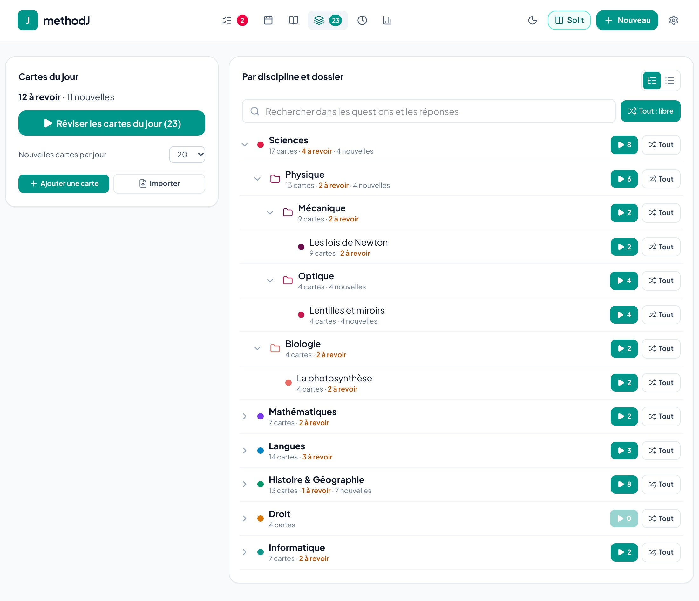

The full-screen player grades each answer (Again, Hard, Good, Easy) and shows the delay before the next review; on a diagram you hide areas (rectangles, ovals or polygon outlines) and guess one area at a time.

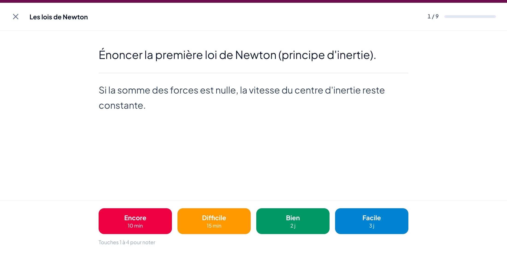

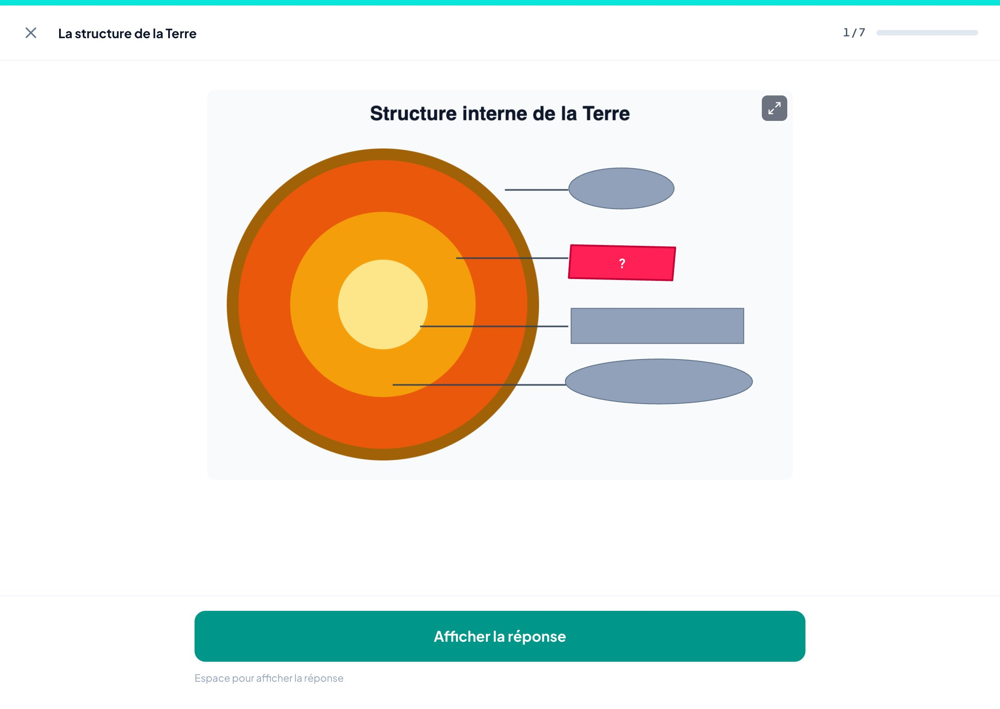

### Statistics

Progress through the syllabus (courses started, pace), the last 7 days against the 7 before, upcoming load over 14, 30 or 60 days, memorisation per J step, **gap to the original plan** (each J's planned date is frozen when J0 is completed; postponing a slot does not change it) and, if you enter an **exam date** (Preferences > Exam), a projection of the pace you need; without a date, nothing is shown.

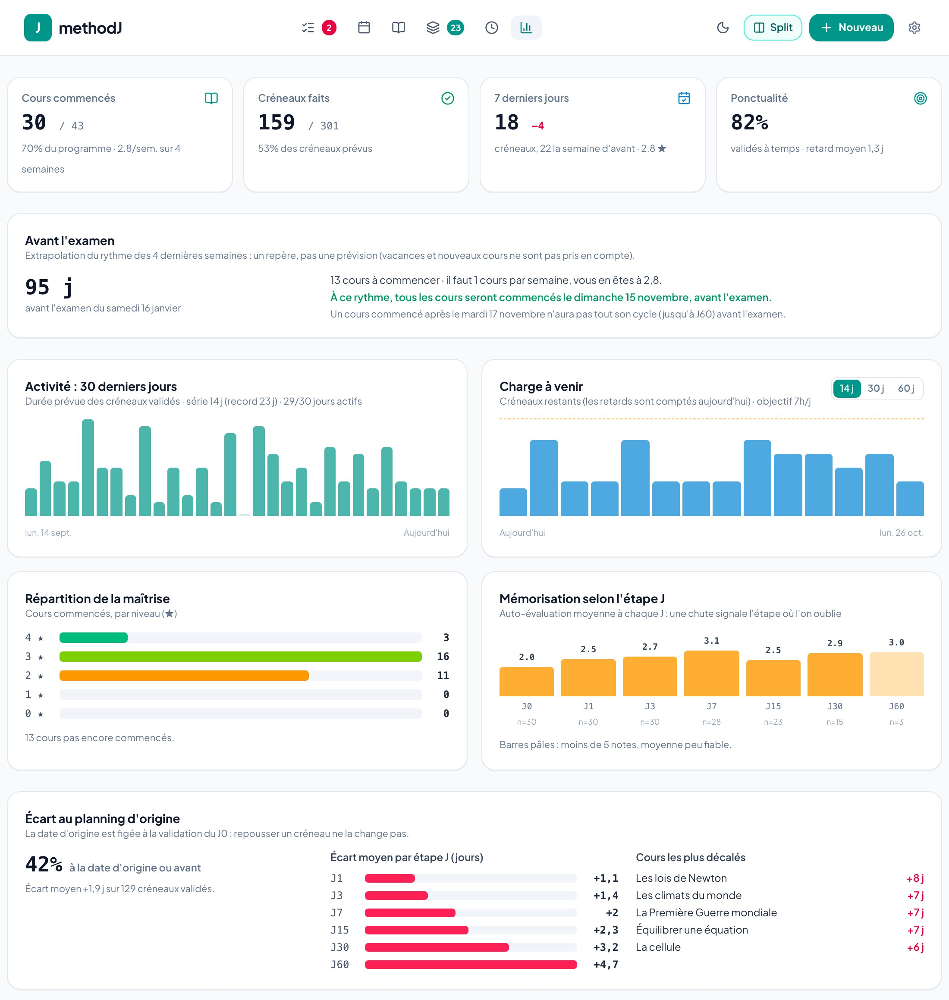

For cards: estimated and actual retention, cards reviewed per day, review-log activity, cards due over 30 days, often-forgotten cards, and progress by subject.

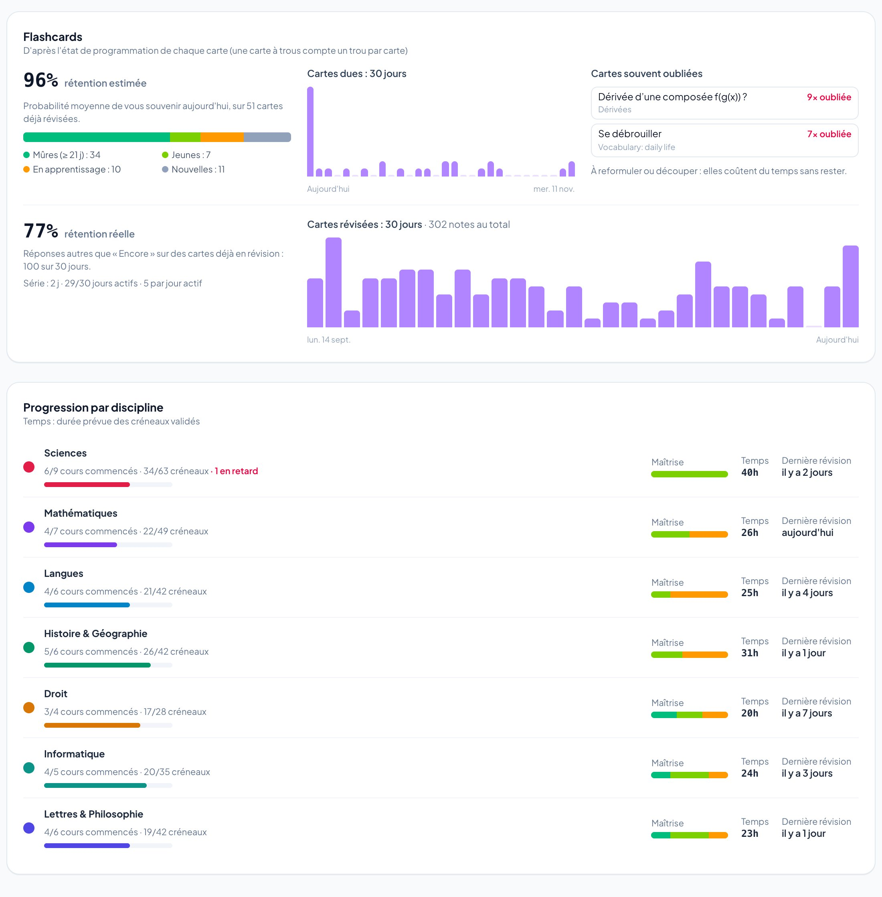

### Calendar and backups

- **`.ics` export** of your slots (Google Calendar, Apple, Outlook) and, if you set it up, **direct sending to a dedicated Google calendar**, updated on each send.
- **JSON backup** at any time (export / import) and, when signed in with Google, a **“Save to Drive”** button that puts the export in a folder of your Drive (one file per day). Sending to Google Calendar and Drive is optional: see [docs/GOOGLE_CALENDAR_SETUP.en.md](docs/GOOGLE_CALENDAR_SETUP.en.md).

### And also

- **Interface in French and English**: the browser language is followed on first launch, then adjustable in Preferences > Display. Light or dark theme.
- **Installable** on iPad / phone / computer (PWA), full screen.
- **Your data stays yours**: everything is stored in your browser, with JSON export / import. Syncing between devices is **optional** (your own Firebase project, see below).

<details>
<summary>Dark theme</summary>


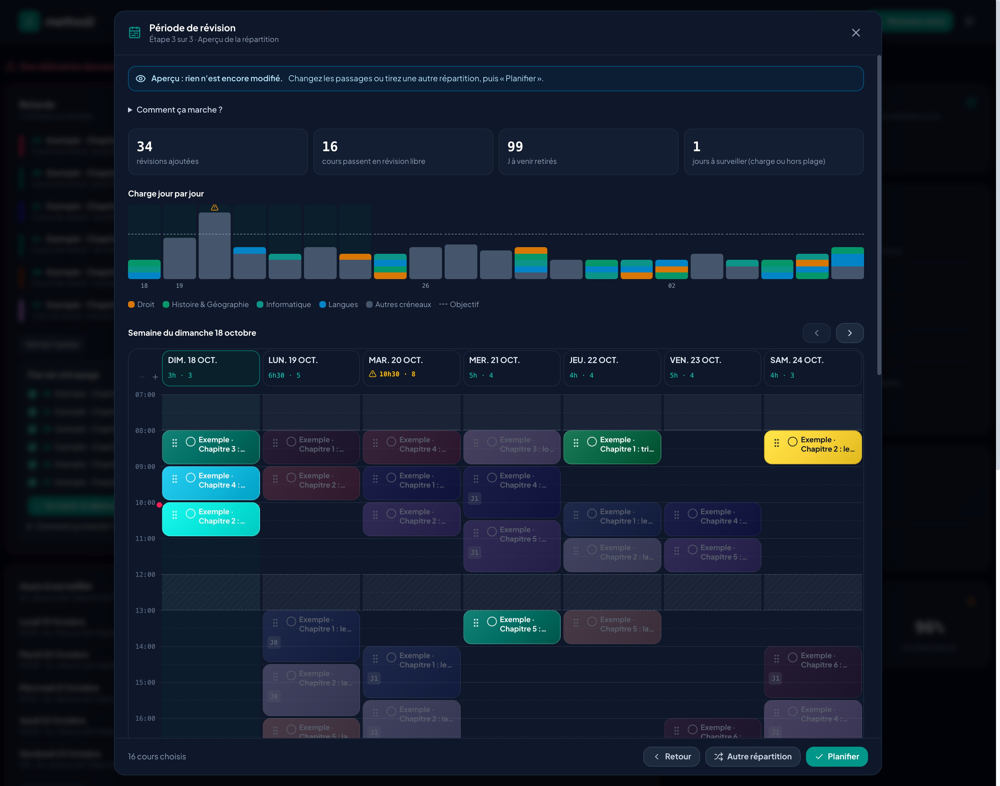

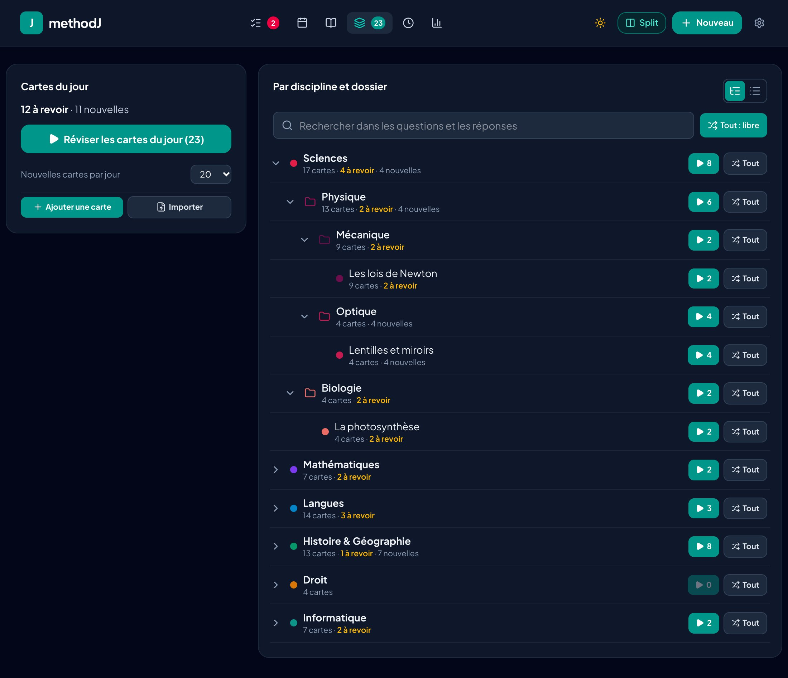

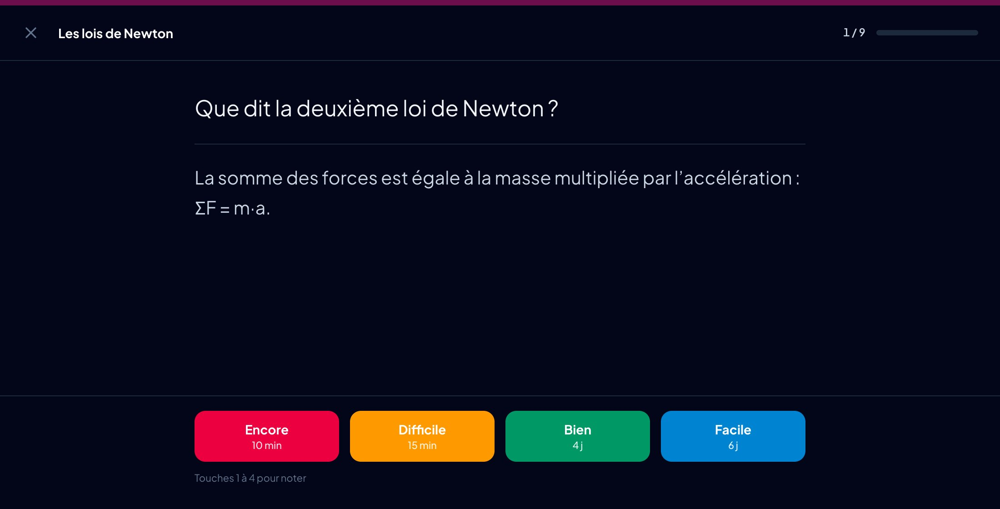

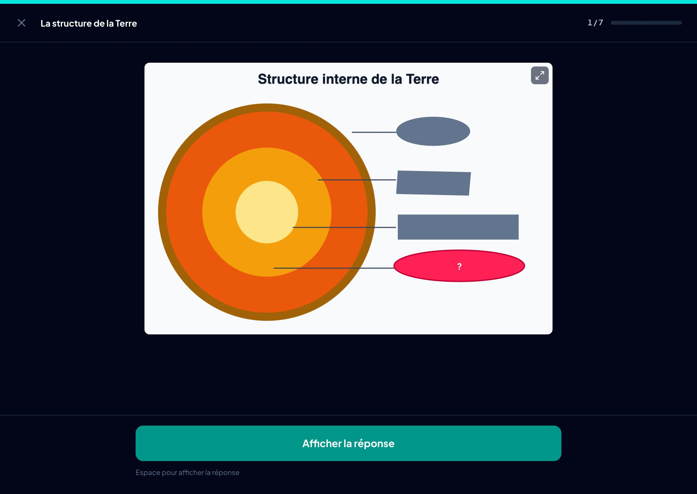

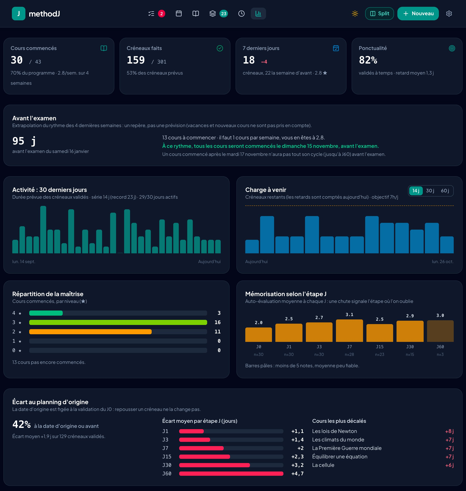

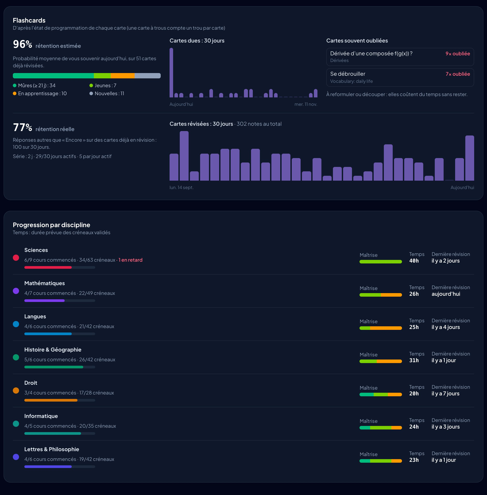

</details>

## Quick start (no account, local)

Requirement: [Node.js](https://nodejs.org) 22 or later.

```bash
git clone <this-repository-url>
cd <folder>
npm install
npm run dev        # http://localhost:3000
```

Without Firebase configuration methodJ runs entirely locally. The "Cloud" tab in Preferences says so.

## Sync your devices (optional)

Syncing uses **your own** free Firebase project (Firestore + Google sign-in). Nothing is shared with anyone: your data lives in your account.

```bash
./scripts/setup-firebase.sh
```

The script creates the project, the database and the security rules, writes the configuration and can publish the app. Two settings remain to be done in the Firebase console: everything is explained in [docs/CLOUD_SETUP.en.md](docs/CLOUD_SETUP.en.md).

## Useful commands

| Command | Purpose |
|---|---|
| `npm run dev` | Dev server (port 3000) |
| `npm test` | Unit tests |
| `npm run lint` | TypeScript check |
| `npm run build` | Builds `dist/` |
| `./deploy.sh` | Checks, builds and publishes to Firebase Hosting (`--rules` for rules only, `--all` for both) |

## Updating

After a `git pull`, run `npm install` again. If the release adds data fields, also republish the security rules: `./deploy.sh --rules`.

## Contributing

Suggestions and fixes are welcome (issues and pull requests). Please run `npm run lint` and `npm test` before proposing a change.

## License

[GNU AGPL v3](LICENSE). If you host a modified version of methodJ for other people, you must publish its source code.
