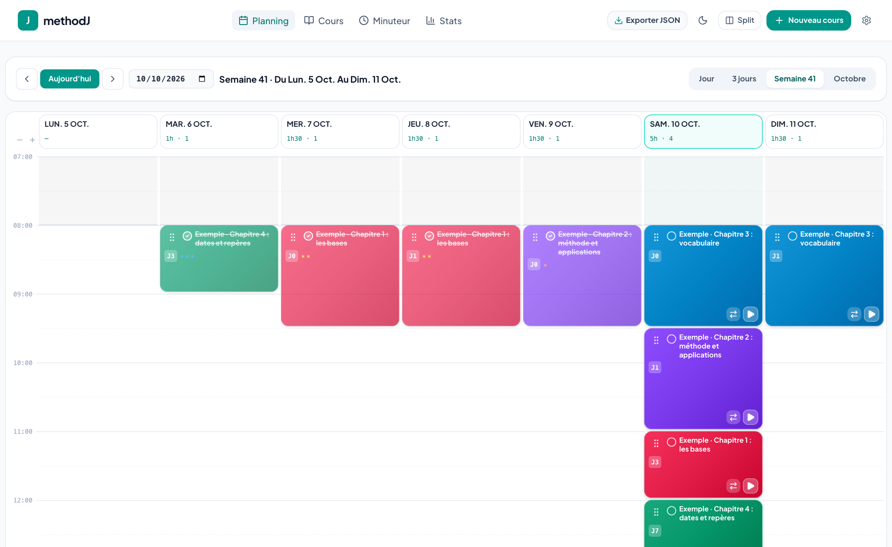
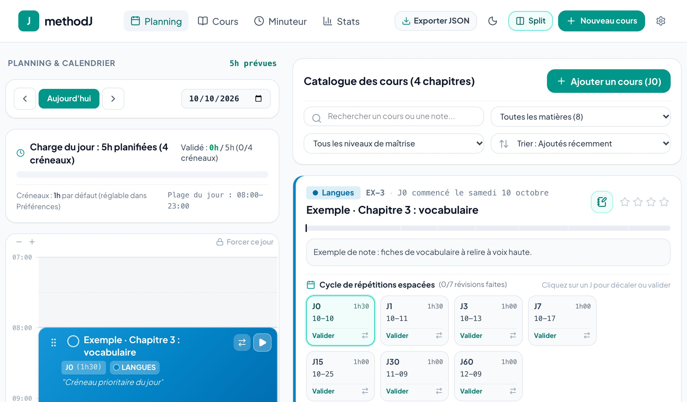
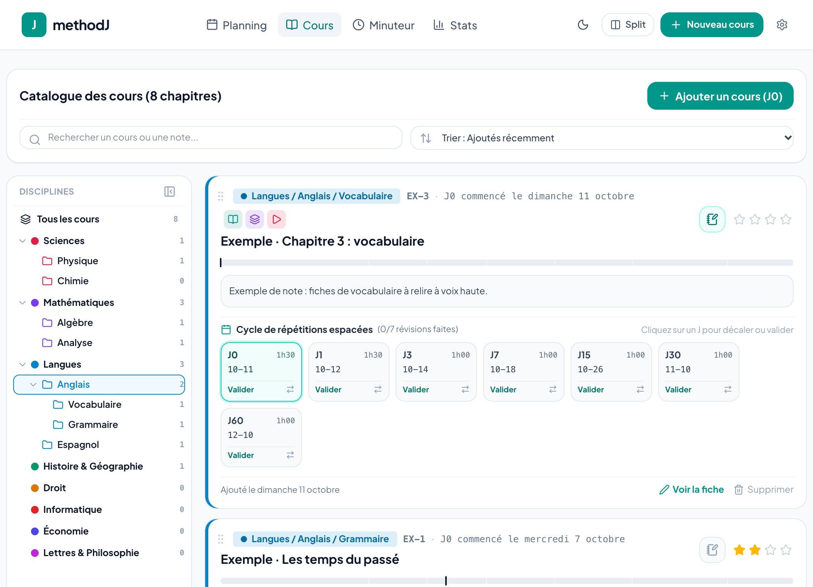
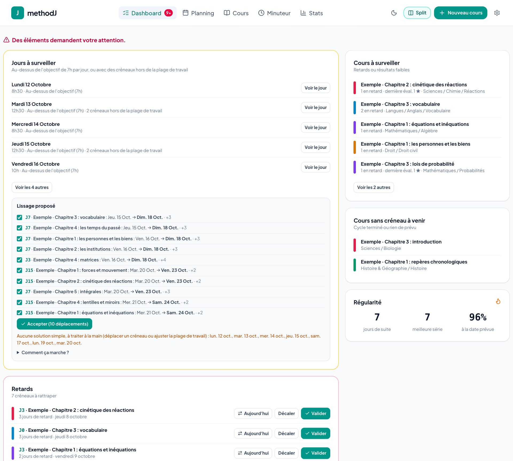
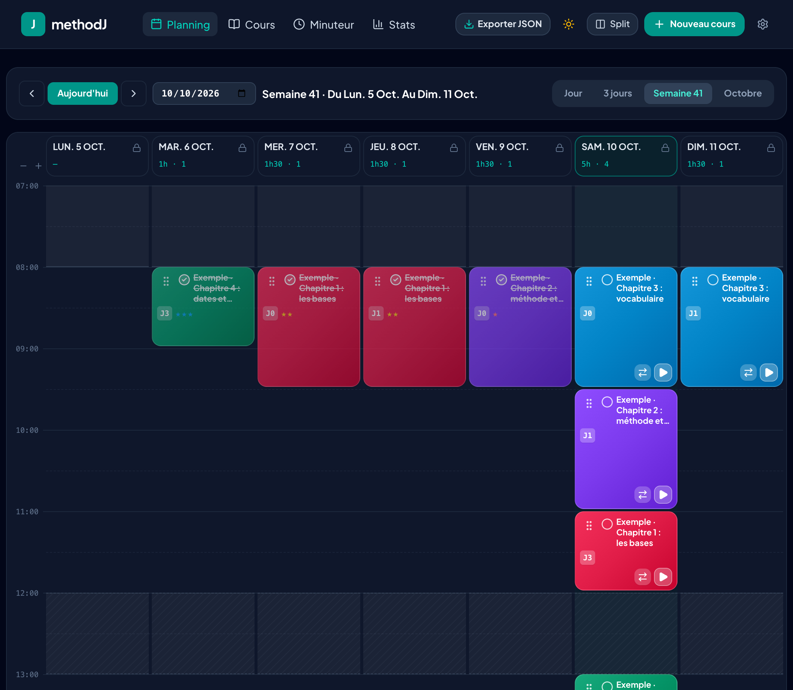
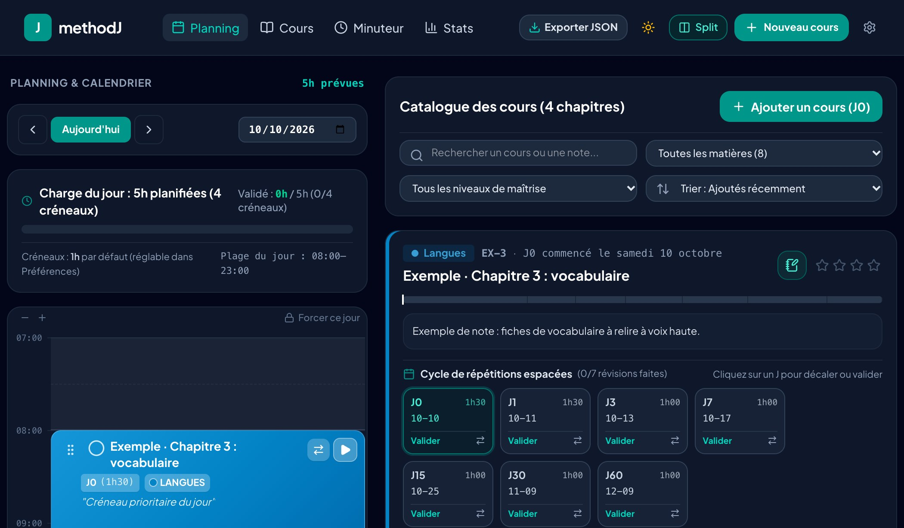
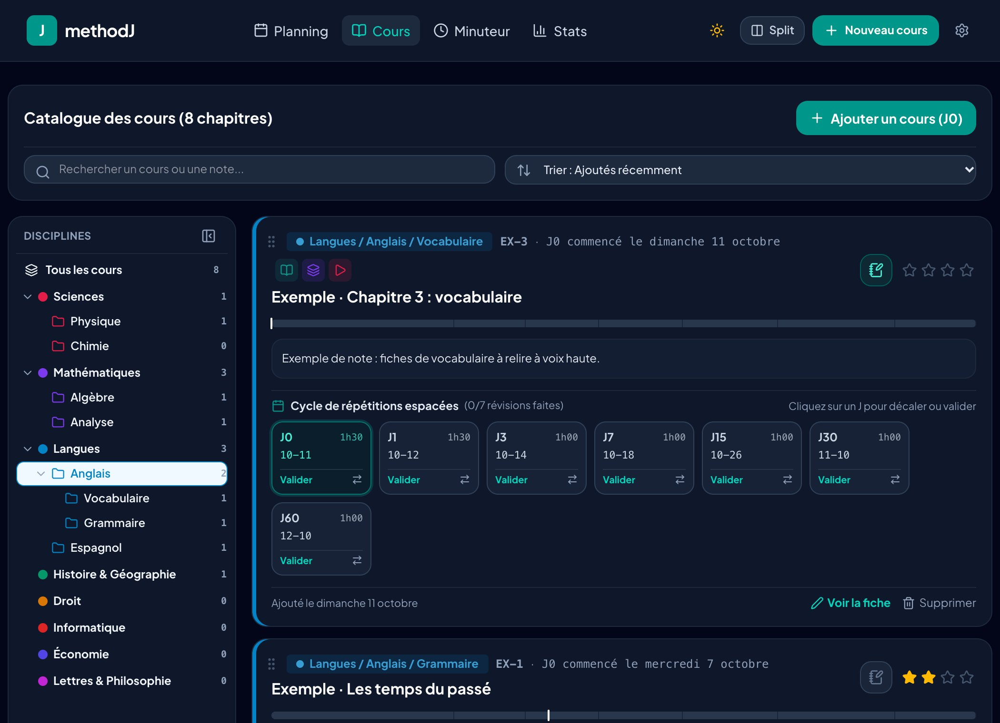
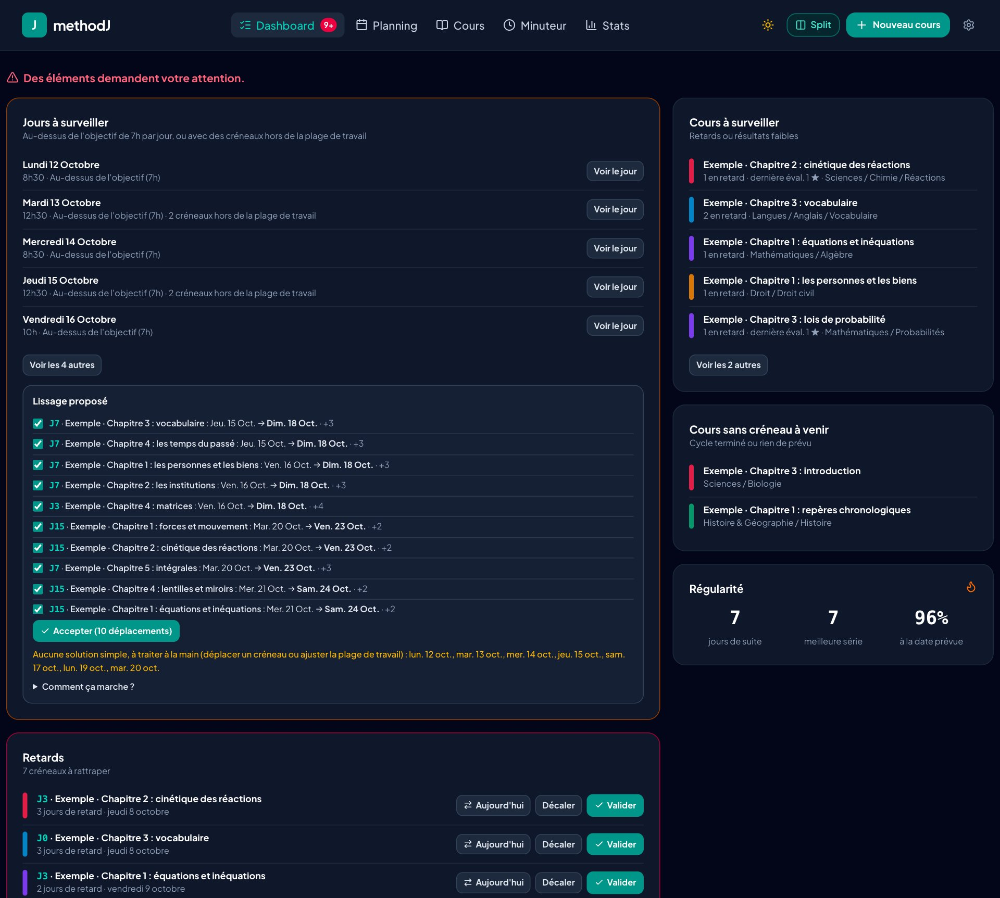

# methodJ · Planificateur de révisions en répétition espacée

🇫🇷 Français · [🇬🇧 English](README.en.md)

methodJ planifie vos révisions selon la **méthode des J** (répétition espacée) : à chaque cours, des créneaux de révision sont placés à J0, J1, J3, J7, J15, J30, J60… Vous gardez la main : glisser-déposer, décalage en cascade, chronomètre, statistiques.

> ⚠️ methodJ est un outil d'organisation du travail. Il ne fournit aucun contenu médical ni avis médical.

**Planning de la semaine** : les créneaux se déplacent au doigt ou à la souris, d'un jour à l'autre.



**Écran scindé** (tablette ou grand écran) : le planning du jour à gauche, le catalogue des cours et leur cycle de répétitions (J0, J1, J3…) à droite.



**Catalogue et arborescence** : rangez vos cours par discipline › dossier › sous-dossier, filtrez en un clic, et attachez des liens (Drive, flashcards…) à chaque cours.



**Dashboard** : tout ce qui demande une action au même endroit (retards, jours au-dessus de votre objectif, créneaux hors de la plage de travail), avec des propositions de lissage et de rattrapage que vous cochez avant de les accepter. Les règles sont décrites dans [docs/PLANNING_RULES.md](docs/PLANNING_RULES.md).



<details>
<summary>Thème sombre</summary>









</details>

## Fonctionnalités

- **Méthode des J personnalisable** : choisissez vos intervalles, enregistrez vos réglages par défaut, durée de créneau par défaut et exceptions par J.
- **Vues Jour, N jours, Semaine et Mois**, avec échelle horaire, créneaux déplaçables au doigt ou à la souris (aussi d'un jour à l'autre), plages horaires et pauses (déjeuner…) par jour de la semaine, que l'on peut lever pour un jour précis.
- **Décalage en cascade** : si vous repoussez un créneau, les suivants non faits suivent.
- **Chronomètre de révision** avec notes et auto-évaluation de la maîtrise.
- **Catalogue de cours**, disciplines et couleurs personnalisables (import CSV/JSON), avec une arborescence (discipline › dossier › sous-dossier) pour ranger et filtrer les cours, et des liens (Drive, flashcards…) attachés à chaque cours, et un export `.ics` de vos créneaux (Google Agenda, Apple, Outlook).
- **Dashboard** : retards, jours surchargés ou avec des créneaux hors plage, lissage de charge et rattrapage proposés (jamais appliqués sans votre accord, annulables), état de la synchronisation.
- **Statistiques** : série, retards, charge à venir, rétention par J.
- **Interface en français et en anglais** : la langue du navigateur est suivie au premier lancement, puis réglable dans Préférences > Affichage.
- **Installable** sur iPad / téléphone / ordinateur (PWA), plein écran.
- **Vos données vous appartiennent** : tout est stocké dans votre navigateur, avec export / import JSON. La synchronisation entre appareils est **facultative** (votre propre projet Firebase, voir ci-dessous).

## Démarrage rapide (sans compte, en local)

Prérequis : [Node.js](https://nodejs.org) 22 ou plus.

```bash
git clone <URL-de-ce-depot>
cd <dossier>
npm install
npm run dev        # http://localhost:3000
```

Sans configuration Firebase, methodJ fonctionne entièrement en local. L'onglet « Cloud » des Préférences l'indique.

## Synchroniser vos appareils (facultatif)

La synchronisation utilise **votre** projet Firebase gratuit (Firestore + connexion Google). Vous n'avez rien à partager avec personne : vos données sont dans votre compte.

```bash
./scripts/setup-firebase.sh
```

Le script crée le projet, la base et les règles de sécurité, écrit la configuration et peut publier l'application. Deux réglages restent à faire dans la console Firebase : tout est expliqué dans [docs/CLOUD_SETUP.md](docs/CLOUD_SETUP.md).

## Commandes utiles

| Commande | Rôle |
|---|---|
| `npm run dev` | Serveur de développement (port 3000) |
| `npm test` | Tests unitaires |
| `npm run lint` | Vérification TypeScript |
| `npm run build` | Construit `dist/` |
| `./deploy.sh` | Vérifie, construit et publie sur Firebase Hosting (`--rules` pour les règles seules, `--all` pour tout) |

## Mise à jour

Après un `git pull`, relancez `npm install`. Si la version ajoute des champs de données, republiez aussi les règles de sécurité : `./deploy.sh --rules`.

## Contribuer

Les suggestions et corrections sont les bienvenues (issues et pull requests). Merci de lancer `npm run lint` et `npm test` avant de proposer un changement.

## Licence

[GNU AGPL v3](LICENSE). Si vous hébergez une version modifiée de methodJ pour d'autres personnes, vous devez en publier le code source.
